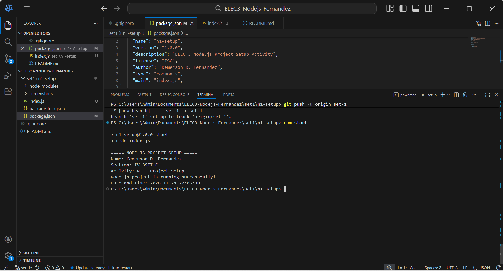
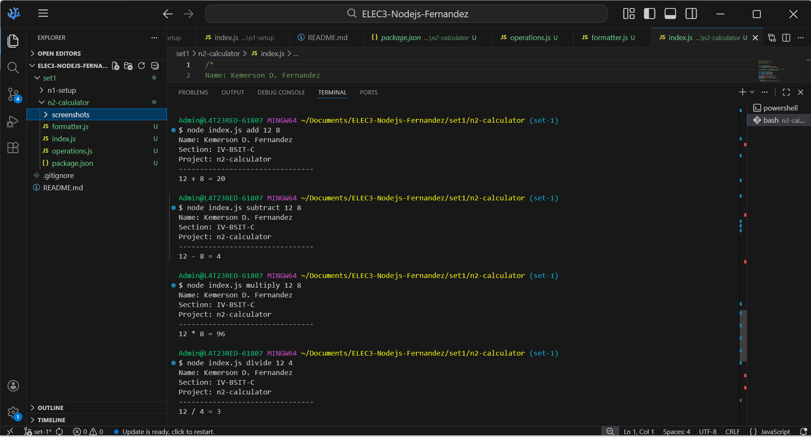
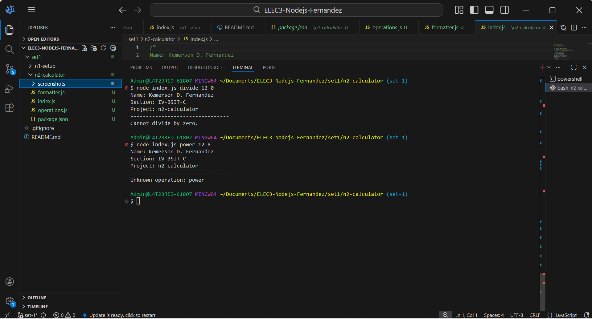
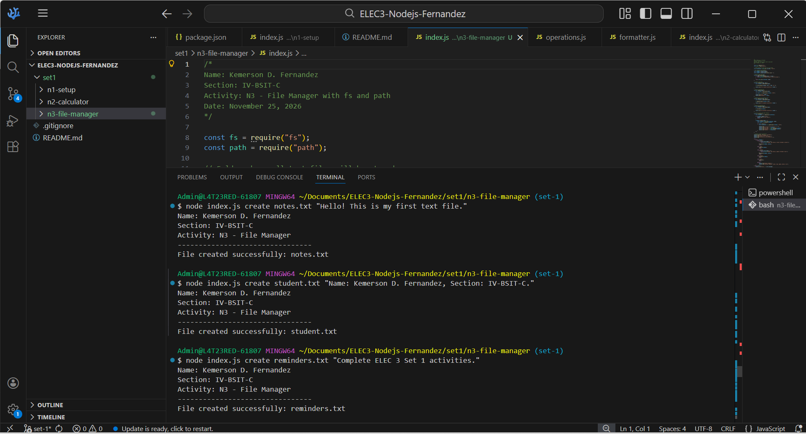
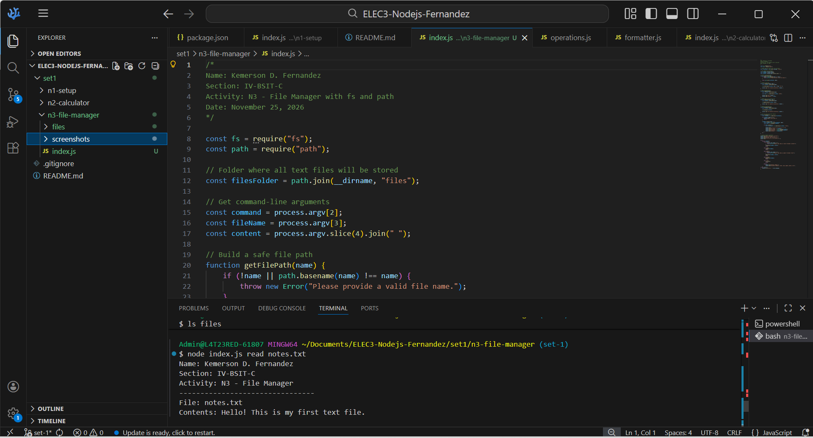
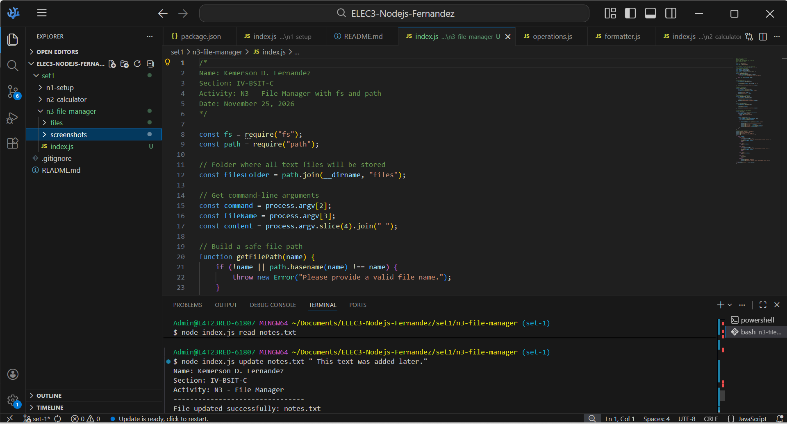
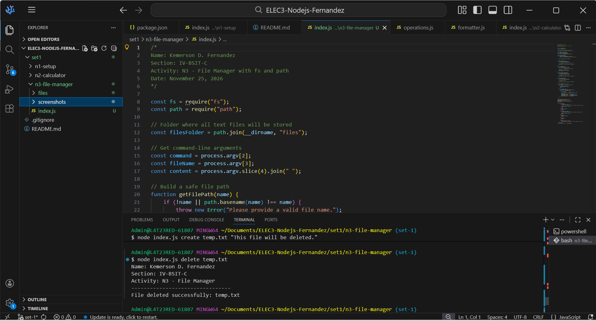
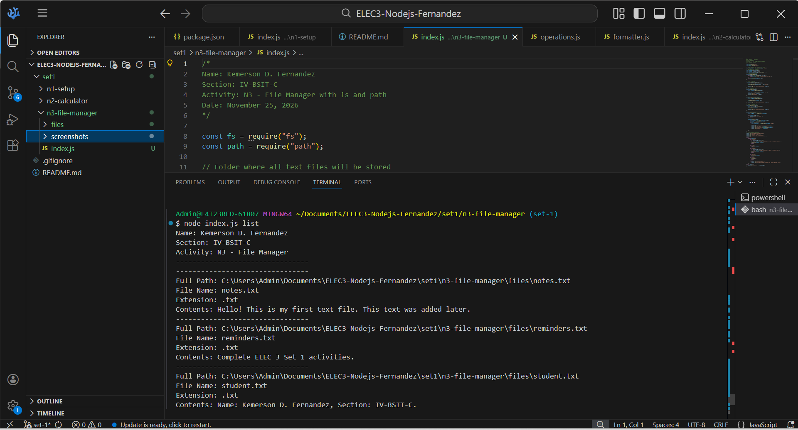
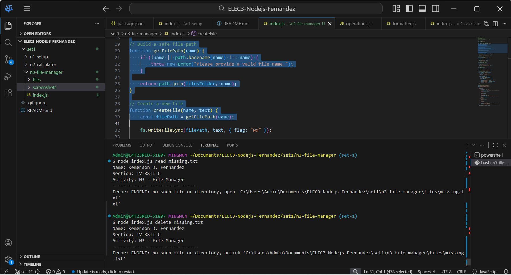

**Name:** Kemerson D. Fernandez  
**Section:** IV-BSIT-C  
**Course:** ELEC 3 – Node.js

---

## Set 1 Activities

### N1 – Project Setup and Package Management
[Open N1 Folder](set1/n1-setup)

- Create a Node.js project and manage npm packages.
- Install and use dependencies.
- Configure npm scripts.

### N2 – Modular Calculator
[Open N2 Folder](set1/n2-calculator)

- Build a calculator using custom Node.js modules.
- Perform basic arithmetic operations.
- Handle invalid operations and division by zero.

### N3 – File Manager with fs and path
[Open N3 Folder](set1/n3-file-manager)

- Create, read, update, and delete text files.
- Display file information using Node.js `fs` and `path` modules.
- Handle errors when accessing nonexistent files.

---

## How to Run

### N1 – Project Setup and Package Management

```bash
cd set1/n1-setup
npm install
npm start
```

### N2 – Modular Calculator

```bash
cd set1/n2-calculator

node index.js add 12 8
node index.js subtract 12 8
node index.js multiply 12 8
node index.js divide 12 4
node index.js average 8 12
```

**Error Handling Tests**

```bash
node index.js divide 12 0
node index.js power 12 8
```

### N3 – File Manager with fs and path

```bash
cd set1/n3-file-manager

node index.js create sample.txt "Hello!"
node index.js read sample.txt
node index.js update sample.txt " Added text."
node index.js list
node index.js delete sample.txt
```

**Error Handling Tests**

```bash
node index.js read missing.txt
node index.js delete missing.txt
```

---

## Screenshots

### N1 – Project Setup and Package Management

**Node.js and npm Version Check**


**Package JSON Configuration**


**Successful npm Start Output**



---

### N2 – Modular Calculator

**Calculator Output**



**Error Handling**



---

### N3 – File Manager with fs and path

**Create Files**



**Read File**



**Update File**



**Delete File**



**List Files**



**Error Handling**



