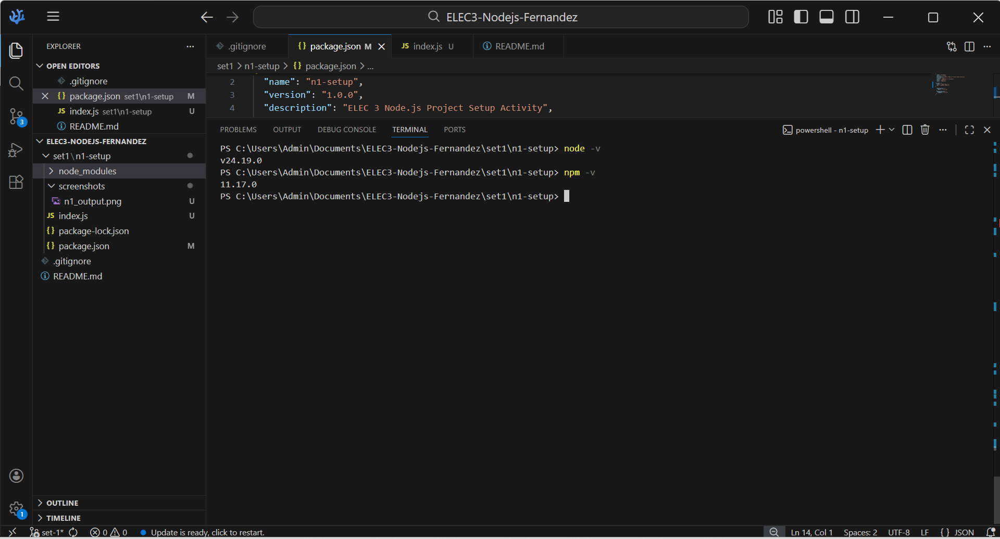

# ELEC 3 – Node.js

Name: Kemerson D. Fernandez
Section: IV-BSIT-C
Course: ELEC 3 – Node.js

## Set 1 Activities

- [N1 – Project Setup and Package Management](set1/n1-setup)
  - Create a Node.js project and manage npm packages.

- [N2 – Modular Calculator](set1/n2-calculator)
  - Build a calculator using custom Node.js modules.

- [N3 – File Manager](set1/n3-file-manager)
  - Manage text files using fs and path modules.

## How to Run

### N1 – Project Setup
```bash
cd set1/n1-setup
npm install
npm start
```

## Screenshots

### N1 – Project Setup and Package Management

**Node.js and npm Version Check**



**Package JSON Configuration**


**Successful npm start Output**


## N2 - Modular Calculator

A command-line calculator built using Node.js custom modules.

### Features
- Addition
- Subtraction
- Multiplication
- Division
- Average
- Error handling for division by zero and unknown operations
- Uses process.argv, require(), and the built-in path module

### How to Run

```bash
cd set1/n2-calculator

node index.js add 12 8
node index.js subtract 12 8
node index.js multiply 12 8
node index.js divide 12 4
node index.js average 8 12

### Error Handling Tests

Test division by zero:

```bash
node index.js divide 12 0
```

Test an unknown operation:

```bash
node index.js power 12 8
```

```

### Screenshots

**Calculator Output**


**Error Handling**


